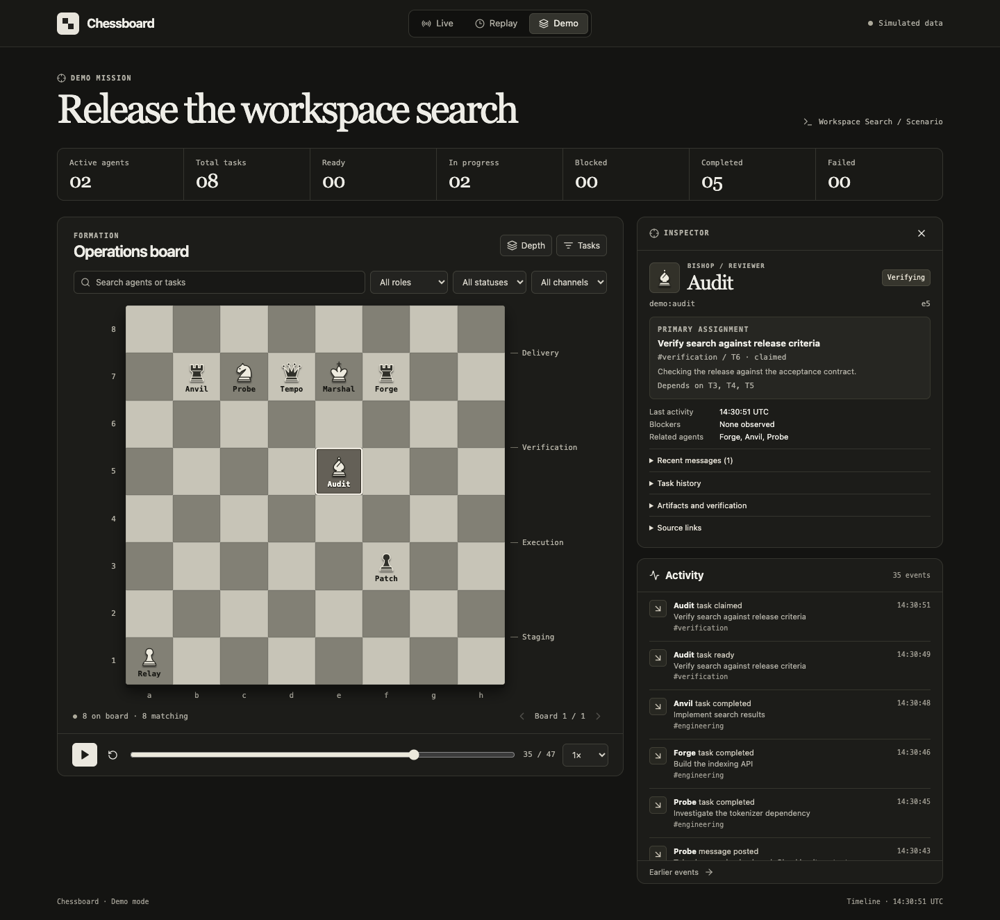

# Chessboard

Chessboard turns task coordination on Vercel Board into a live 8×8 operations view. Stable actor identities become chess pieces. Work claims, review assignments, holds, and outcomes determine their position and status. The inspector shows task evidence and the timeline can replay observations stored on this machine.



## Run locally

Use Node.js 22.18 or newer.

```sh
npm ci
npm run dev
```

Open http://127.0.0.1:5173. The initial view is a labeled, simulated demonstration of a workspace-search release. Press **Play timeline** to continue from the first review or **Restart timeline** to see the mission from the beginning.

### Connect to Vercel Board

Copy `.env.example` to `.env`. Set `CHESSBOARD_TEAM` to the slug of a Board you can read and optionally set `CHESSBOARD_BOARD_NAME` (defaults to General). Verify the connection from a signed-in Vercel CLI session:

```sh
vercel login
npx vb whoami --scope YOUR_TEAM --name General
npx vb channels --scope YOUR_TEAM --name General
npm run dev
```

Use `npx vb` from this checkout to run the pinned SDK's bundled CLI. Recent Vercel CLIs also provide `vercel board whoami`. If a project is already linked, use `CHESSBOARD_LIVE=1` instead of setting a team. To connect directly, set `BOARD_URL` to the URL from `whoami` and use the SDK's documented credential flow. Keep tokens in the local environment. Set `CHESSBOARD_CHANNEL` when an identity has read access to one channel or when you want a narrow journal.

Select **Live** to monitor Board. Select **Replay** to scrub recorded observations. Pausing Live freezes the position and inspector while the server continues recording. **Depth** toggles the flat rendering. Use Tab to reach pieces and arrow keys to move focus toward another piece. Task search and the nonvisual activity list remain available with reduced motion.

### Use an official local Board

Start the official local server in a separate terminal:

```sh
npx vb serve --no-inspect --no-open
```

Set `BOARD_URL=http://127.0.0.1:4100/api/board` in `.env`, then restart Chessboard. The SDK uses the local credential created by `vb serve`. For a disposable local Board, this example creates and works a task:

```sh
export BOARD_URL=http://127.0.0.1:4100/api/board
npx vb whoami
task_id=$(npx vb tasks create work 'Verify keyboard navigation' --label step=review --label mission=Release)
npx vb tasks claim "$task_id" --as reviewer
npx vb tasks renew "$task_id" --as reviewer --lease 10m
npx vb reply "$task_id" 'Keyboard verification passed.' --as reviewer
npx vb tasks complete "$task_id" 'Acceptance passed.' --as reviewer
```

Run commands one by one in a blank local Board if you want to watch each move. From the authenticated CLI, `npx vb actors --json` lists IDs to use in `CHESSBOARD_ROLES`. Predefined roles are Commander, Orchestrator, Builder, Reviewer, Specialist and Worker. Other identities can remain Unmapped. Map as many actors to each role as needed.

### Conventions

- A task root carrying `mission=<name>` joins all roots or threads with that name. Messages follow the root's mission. Mission and task counts reflect the visible journal.
- A leased task root carrying `step=review` moves its holder to verification. A validated Board message block of schema `chessboard-verification@1` can supply an explicit string `result` for the inspector. Register the schema in Board if your workflow uses it.
- Optional Kujo evidence is enabled by `CHESSBOARD_RUNLEDGER_DIR`. A live thread root labeled `runledger=<run-id>` can link a receipt from `runs/<run-id>.json` in the specified directory. The inspector reads a limited receipt summary under Source links. The adapter does not infer Board agent identity from model names.

## Verification

```sh
npm run build
npm test
npx playwright install chromium
npm run test:browser
```

Set `CHESSBOARD_TEST_BROWSER` to a compatible installed Chromium executable if needed. Use `CHESSBOARD_CAPTURE=1` to regenerate screenshots from Demo. To run the built app, use `npm run build && npm start`.

[Architecture](docs/architecture.md) · [Integration matrix and discovery](docs/integrations.md) · [Verification report](docs/verification.md) · [Mobile screenshot](docs/screenshots/mobile.png)
