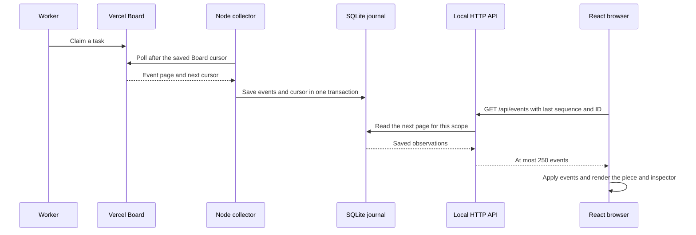

# From a task claim to a chess move

At 0:53 in the Tideway recording, a reviewer finds that a landing page's email field has no accessible label. The test failure appears in Chessboard. A builder fixes the label, the planner reopens the review, and the reviewer checks the page again. Around 1:24, the delivered page opens and the form is submitted with the keyboard. The first failure was planted for the exercise. The Board events, Chromium checks, and resulting page came from the local run. [Recording and verification receipt](demos/README.md)

The useful question starts before the animation. How can an interface show who claimed a task, explain why the status changed, and show the same handoff again tomorrow? Chessboard answers by recording what it observed and working out the visible board from that history. This tutorial follows one review claim from the worker's command to the piece you can click. [Repository at the tutorial's source revision](https://github.com/robertdevore/chessboard/tree/47b560a)

## What you’ll learn

By the end, you should be able to do five things.

1. Trace a worker’s Board action across the server, database, and browser.
2. Read TypeScript types that distinguish reported work from a status the app derives.
3. Explain how a SQLite transaction protects events and their saved position in the feed.
4. Predict how the same records drive a chess move, an inspector, and a replay.
5. Design a regression test for a stale writer or an expiring claim and interpret a targeted performance measurement.

## Start with the work, then look at the interface

Vercel Board keeps channels, threads, and tasks. A thread groups a discussion around one root message. When that root represents a task, it can carry a state, a claim, dependencies, and a result. A claim has a *lease*, a time limit on its validity. Separate workers can use those shared records to decide what is ready and to attach evidence of what they did. [Vercel Board documentation](https://vercel.com/docs/board)

Chessboard reads Board through its SDK, a library that gives the Node server methods such as `poll` and `thread`. Chessboard presents **Live** observations, **Replay** of observations this installation saved, and **Demo**, an isolated set of fixtures. Board remains in charge of changes to tasks. Local Qwen workers drafted the checklist and copy for Tideway, and scripts built and tested its HTML. Chessboard observed their work. Its runtime neither starts those workers nor needs a model to replay their activity. [Demo notes](demos/README.md) · [Chessboard API](../server/api.ts)

The commit history shows the boundaries taking shape. The first commit established the event model and deterministic movement. Later commits added the Vercel Board journal and then the browser interface. The Tideway recording followed those features. The hardening pass added recovery for a restored journal and stopped rebuilding the idle view every second. Those are dates and changes the repository can establish. The tradeoffs discussed below are interpretations of the resulting design. [Commit history](https://github.com/robertdevore/chessboard/commits/47b560a) · [Hardening audit](audits/repository-hardening.md)

## Follow a review claim from Board to the browser

A worker claims a task in Board. Chessboard’s collector waits for an event page, converts the records it recognizes, and writes them to SQLite. The browser asks the local HTTP API for saved observations and folds them into its view. Here *fold* means to apply records in order, carrying the state from one record to the next.



Notice the two paths that cross a network boundary. The collector talks to Board with server-side credentials. The browser talks to Chessboard’s loopback API. Even with the official local Board server, those are separate services. HTTP is the request-and-response protocol they use. The local API defines the route the browser can call and the data it can expect back. The diagram shows a page containing a claim. Either poll can also return without any new work. [Collector](../server/collector.ts) · [Local API](../server/api.ts) · [Browser feed](../src/useFeed.ts)

The collector uses *long polling*. A request asks Board to wait for new records, up to the requested wait period. The code passes `wait: 15` to the SDK and uses a saved cursor, an opaque marker supplied by Board. The browser runs a separate loop against the local API. It usually schedules its next read after 1.2 seconds and pages faster when the last response indicates more. A browser tick and a Board poll need not occur together. [Collector polling](https://github.com/robertdevore/chessboard/blob/47b560a/server/collector.ts#L77-L102) · [Browser polling](https://github.com/robertdevore/chessboard/blob/47b560a/src/useFeed.ts#L23-L68)

### Convert outside data into a shape you own

TypeScript adds types to JavaScript. A type describes values a function expects or returns. It helps the editor and compiler spot mistakes during development. A type on its own cannot check JSON from another process at runtime. That distinction matters in `useFeed`, where the app declares the expected response type after parsing JSON from its own server. [TypeScript handbook](https://www.typescriptlang.org/docs/handbook/2/everyday-types.html) · [Feed client](../src/useFeed.ts)

Here is the actual `Event` type from `src/domain.ts`. [Source](https://github.com/robertdevore/chessboard/blob/47b560a/src/domain.ts#L16-L21)

<!-- excerpt: ../src/domain.ts -->
```ts
export type Event = {
  id: string; source: Source; sourceEventId: string; boardId: string; channelId?: string; threadId?: string
  taskId?: string; actor?: Actor; type: string; timestamp: number; order: number
  evidence: 'observed' | 'snapshot' | 'simulated'; task?: Task; relatedAgents: string[]
  message?: Message; metadata?: { verification?: string; mission?: string; mentions?: string[] }
}
```

The question mark in `task?: Task` permits records without a task. If code needs to use the task, it can first check that the field exists. The vertical bars in the `evidence` field make a *union*, which here restricts the field to three literal strings. The field tells a reader how the record entered the app. `source` identifies where it came from. [Event type and reducer](../src/domain.ts)

`normalize` marks a recognized event received from the feed as `observed`. It maps Board’s task and message fields into the local types, including the claim holder, lease expiry, and review label. When starting without a checkpoint, the collector first reads the feed head, then gathers current actors, tasks, and recent messages. It records those state samples as `snapshot` and resumes polling from the saved head. A snapshot can establish the task’s current state. It contains no record of every step that led there. The projection checks message versions so a feed record with an older version cannot overwrite current task data. The app can therefore show existing work on first launch and begin a replay at the point it observed the system. [Normalizer](../server/normalize.ts) · [Bootstrap](https://github.com/robertdevore/chessboard/blob/47b560a/server/collector.ts#L19-L61) · [Version checks](https://github.com/robertdevore/chessboard/blob/47b560a/src/domain.ts#L134-L156)

This is an adapter pattern. The SDK can describe many Board operations, while the UI understands one local model for actor identity, task state, and evidence. The tradeoff is that the conversion layer must keep pace with changes to the external API. In another project, the same boundary can keep a payment processor's or build service’s response shape from spreading through every component.

### Keep the observations and the checkpoint together

SQLite is a database library that reads and writes a local file. Chessboard stores events and the last accepted Board cursor in separate tables in that file. A *transaction* lets it make both writes as one unit. If the event write fails, a rollback leaves the old checkpoint available for the next attempt. If the checkpoint advanced first and the process stopped before saving the page, a restart could skip those observations. [Journal](../server/journal.ts) · [SQLite transactions](https://www.sqlite.org/lang_transaction.html)

There is a second failure mode. Two collectors can poll from the same cursor. A faster one can commit while the slower one is still waiting for the network. When the slower request arrives, SQLite must compare its original cursor with the current one *inside* the write transaction. The first part of `append` does that comparison. This is a contiguous excerpt from the function. [Source](https://github.com/robertdevore/chessboard/blob/47b560a/server/journal.ts#L28-L35)

<!-- excerpt: ../server/journal.ts -->
```ts
append(scope: string, events: Event[], cursor: string, previous: string | undefined) {
  if (!events.length && previous === cursor) return cursorFor(scope) === previous
  db.exec('BEGIN IMMEDIATE')
  try {
    if (cursorFor(scope) !== previous) {
      db.exec('ROLLBACK')
      return false
    }
```

`cursor` is the checkpoint the caller proposes. `previous` is where that request started. It can be `undefined` on the first write. `BEGIN IMMEDIATE` starts the write transaction before the check. If the check succeeds, the rest of `append` writes events and the checkpoint and then commits. The database also enforces uniqueness on the pair `(scope, id)`, so receiving the same event again does not add a second row. The checkpoint check protects the order of competing writers. The unique constraint protects the identity of individual records. [Full journal function](https://github.com/robertdevore/chessboard/blob/47b560a/server/journal.ts#L15-L47)

Three values matter when replay is involved.

| Value | Question it answers |
| --- | --- |
| Board cursor | Where should the collector resume at the source? |
| Local sequence number | Which saved rows should the HTTP API return next? |
| Last event ID, sent as `seen` | Is the row at this sequence number still the one the browser remembers? |

A database restored from a backup can reuse the same sequence number for a different record. The browser sends both the position and the ID. If the row is missing or the ID differs under the same scope, the API sends a fresh first page with `reset`. The client replaces the earlier history and resets the playback position. A useful habit for any resumable API is to ask whether the position still refers to the same data after a restore. [API resume check](https://github.com/robertdevore/chessboard/blob/47b560a/server/api.ts#L84-L95) · [Restore regression](https://github.com/robertdevore/chessboard/blob/47b560a/tests/board.test.ts#L142-L175)

### Turn a task state into a visible piece

In the normalized data, a review claim is still a task in the `claimed` state. The optional `step=review` label tells Chessboard which status to show. The status function narrows the possible task state in a `switch`. In the `claimed` branch it checks the expiry first, then derives either `Verifying` or `Executing`. This excerpt begins inside that function. [Source](https://github.com/robertdevore/chessboard/blob/47b560a/src/domain.ts#L43-L49)

<!-- excerpt: ../src/domain.ts -->
```ts
switch (assignment?.task.state) {
  case 'claimed':
    if (assignment.task.leaseUntil !== null && assignment.task.leaseUntil <= time) return 'Unknown'
    return assignment.task.step === 'review' ? 'Verifying' : 'Executing'
  case 'blocked': return 'Blocked'
  case 'completed': return 'Delivered'
```

`assignment?.task.state` uses optional chaining. With no assignment, the switch reaches its default instead of trying to read a property from an absent value. The question mark and colon in the last expression of the `claimed` branch choose between two strings. If the lease has expired, Chessboard reports uncertainty about the assignment. A timer in the dashboard cannot establish whether a worker is still running. [Status logic](../src/domain.ts)

`advance` maintains maps keyed by actor, task, and message IDs. A map lets the code retrieve a record by its ID. When an actor has several assignments, the reducer sorts them to find a primary one and keeps the others available for inspection. `allocate` uses the resulting status to choose a zone on the board. It starts with an occupied-square set and searches candidates in a fixed order. A piece can keep its square when blocked or failed, and new pieces can overflow to another board. With the same ordered inputs, role mapping, and evaluation time, replay can reproduce the result. [Projection and allocation](../src/domain.ts)

React components describe what the interface displays from that state. A click on a piece calls `selectAgent`. It stores the actor ID, clears a selected task, and selects the piece’s board. On the next render, `App` looks up that actor and passes it to `Inspector`. The inspector shows the primary assignment, related messages, and evidence it can find in the recorded data. Setting UI state is enough to open it. The browser can request additional source links when the corresponding details section opens in Live mode. [App and inspector](../src/app.tsx) · [On-demand source links](../src/threadEvidence.tsx)

React’s `useEffect` connects the app to external work such as HTTP requests and timers. The `useFeed` hook starts polling when a Board-backed mode is active. Its cleanup aborts the pending request and clears the scheduled timer. The same pairing applies to subscriptions and browser listeners. Decide when the work starts, then define what ends it. [Feed cleanup](../src/useFeed.ts) · [React Effects](https://react.dev/reference/react/useEffect)

## Why keep this much machinery on one computer?

A browser that reads Board directly would remove a local service. This design would also need a browser-appropriate authentication scheme and a separate answer for recorded history. A dashboard that keeps only each task’s latest state would be simpler to store. It would lose the failed review that makes the Tideway sequence instructive. The local journal preserves that history, and the server holds Board credentials. The costs include disk use, a startup snapshot, and replay memory that grows with the history the browser loads. Those tradeoffs follow from the current implementation. The local API checks that requests come from the same computer, and the app keeps private data outside the directories it serves. A hosted version for multiple users would need its own authentication and access rules. [Architecture](architecture.md)

Node runs JavaScript outside the browser. In Chessboard it runs the collector and local HTTP server and provides the built-in SQLite library. TypeScript describes the shared shapes. React renders the interface and CSS animates position changes. Vite serves the development modules and bundles the frontend to `dist/`. The real `npm run build` script runs `tsc --noEmit` before Vite, so it checks types without writing a separate set of compiler outputs. `npm ci` installs the locked dependency graph. Playwright drives a browser for tests. It belongs in the development workflow. [Package scripts](../package.json) · [Vite config](../vite.config.ts) · [Vite guide](https://vite.dev/guide/) · [Playwright browser checks](https://playwright.dev/docs/actionability)

## What the tests and timings tell us

The local integration test creates a real SDK task, claims and renews it, closes the collector, completes the task while collection is stopped, and starts collection again. It verifies that replay reaches **Delivered** and that the normalized observations omit the claim token. A separate test uses two SQLite connections to simulate a slow collector. A browser regression controls time and substitutes an API response so it can check lease expiry and journal replacement without waiting for real timers or changing a live database. These tests answer different questions. The first checks the SDK contract and recovery. The second checks the database rule. The third checks the interface response. [Board tests](../tests/board.test.ts) · [Browser regressions](../tests/interface.spec.ts)

The tutorial checkout passed the build and all 17 Node tests. The hardening report also records four browser checks against the verified code, including a connected run on the official local Board. Hosted Board was verified earlier in read-only use and was outside the hardening retest. The Tideway receipt covers the sample page, while the application tests cover Chessboard. [Initial verification](verification.md) · [Hardening verification](audits/repository-hardening.md) · [Tideway test receipt](demos/verification.txt)

The hardening pass changed what happens when the Live view is quiet. Previously a one-second tick could copy the task and message maps and recalculate an unchanged view. The current app schedules work at the next pending lease expiry. `refreshAt` returns the existing state when no relevant deadline has passed. The browser also retains its previous state object on identical poll responses. This moves recurring work closer to the events that can change its result. [Lease helpers](https://github.com/robertdevore/chessboard/blob/47b560a/src/domain.ts#L165-L181) · [Live timer](../src/app.tsx) · [Feed equality check](../src/useFeed.ts)

| Measured quantity | Before | After | Difference |
| --- | ---: | ---: | ---: |
| Median time for 120 idle projection refreshes | 1,056.74 ms | 0.11 ms | 1,056.63 ms less, about 99.99% lower |
| Gzipped Vite JavaScript bundle | 80.61 kB | 81.24 kB | 0.63 kB more, about 0.78% higher |

The projection benchmark used a populated demo projection with 50,000 stored messages and no pending lease expiry. It ran one warm-up and five measured samples on macOS with Node 26.12.1. The median is the middle sample. Each sample timed 120 calls together and checked that task and message counts were preserved. That number describes one local workload with most of its work removed. It gives no measurement of the browser’s startup, large-journal memory, or how fast a human sees a new Board event. The audit includes the command to reproduce it. [Benchmark and verification](audits/repository-hardening.md#performance-and-coverage)

## Try it yourself

### 1. Make a review claim on a local Board

**Objective.** Trace the boundary between an action and its display. **Task.** Install the repo dependencies with `npm ci`. Open the local Board and Chessboard as described in the setup guide, then open **Live**. Use an isolated local Board for this exercise. [Local Board setup](board-setup.md#try-a-local-board)

In a separate terminal, run these commands one at a time. Substitute your local Board port if it differs.

```sh
export BOARD_URL=http://127.0.0.1:4100/api/board
task_id=$(npx vb tasks create work 'Verify the practice handoff' --label step=review --label mission=Practice)
npx vb tasks claim "$task_id" --as reviewer
npx vb reply "$task_id" 'Checked the handoff.' --as reviewer
npx vb tasks complete "$task_id" 'Review passed.' --as reviewer
```

**Where to look.** Follow `server/collector.ts`, then `src/domain.ts`. **Check your work.** Before completion, select the reviewer and look for **Verifying** and the reply in the inspector. After completion, look for **Delivered**. In Replay, scrub before and after the claim. The Board task stays completed while the historical view changes.

### 2. Test a lease at the exact boundary

**Objective.** Use a predictable clock to test a derived status. **Task.** In a practice branch, copy the existing lease-refresh test in `tests/domain.test.ts`. Give the agent a review claim and check that its status is **Verifying** one millisecond before the expiry and **Unknown** at the expiry. **Hint.** Set the input time directly through `refreshAt`. Keep the recorded task in the `claimed` state in both assertions. **Check your work.** Run `npm test`. Your new test should pass without waiting for real time. [Lease test](https://github.com/robertdevore/chessboard/blob/47b560a/tests/domain.test.ts#L109-L118)

### 3. Add a case for a poll that lands late

**Objective.** Protect a write that depends on an earlier read. **Task.** In a practice branch, extend the two-connection test in `tests/board.test.ts`. Have the faster writer save one new event as well as advancing its cursor. Then let the slower writer submit a different event from the old cursor. **Hint.** Keep the previous cursor in a variable before committing the faster write. **Check your work.** `npm test` should confirm that the faster writer’s event appears once, its cursor remains current, and the slower writer’s event is absent. [Existing stale-writer test](https://github.com/robertdevore/chessboard/blob/47b560a/tests/board.test.ts#L122-L140)

## Check your understanding

1. Why can a startup snapshot show a task as completed without knowing the steps that led there?
2. If the process stops after saving a page but before saving its checkpoint, what changes when those writes share a transaction?
3. Why does the browser send an event ID along with its sequence number?
4. A piece moves into **Verifying** after a claim. Which fact came from Board, and which rule came from Chessboard?
5. Why can the idle benchmark drop by about 99.99% while browser startup remains unmeasured?

<details>
<summary>Answers</summary>

1. The snapshot records state as the collector sees it at startup. Earlier transitions require earlier observations.
2. The two writes commit together. If the transaction rolls back, the cursor and the rows both stay at the previous committed position. A retry can ask for the same page.
3. A restore can put a different event at the same sequence number. The ID lets the API recognize that mismatch and restart the browser’s history.
4. Board supplied the claim and the task label. Chessboard interprets `step=review` as **Verifying** and maps that status to the verification zone.
5. The benchmark starts with an existing projection and repeats the quiet refresh path. Startup fetches and parses history and builds the first projection. It is a different workload.

</details>

## Where to go next

Follow a single actor ID from the normalized event to the React key and inspector lookup. Then read how a local scope is formed in `collect` and consider how you would isolate history in a multi-user app. For performance practice, repeat the audit’s benchmark with a claim due to expire. Report that boundary-crossing run separately from the idle one so readers can tell which path each result describes. [Collector and scope](../server/collector.ts) · [React state and Effects](https://react.dev/reference/react/useEffect) · [Hardening benchmark](audits/repository-hardening.md#performance-and-coverage)

**Source revision.** The tutorial describes `47b560a`, following the hardening code in `58ed373` and the Tideway recording in `15b3f2c`. The pinned Board SDK is `@vercel/board` 0.54.0. The walkthrough uses the repository, the release evidence, and the linked primary references. [Source tree](https://github.com/robertdevore/chessboard/tree/47b560a) · [Board SDK source](https://github.com/vercel/board) · [Setup guide](board-setup.md)
